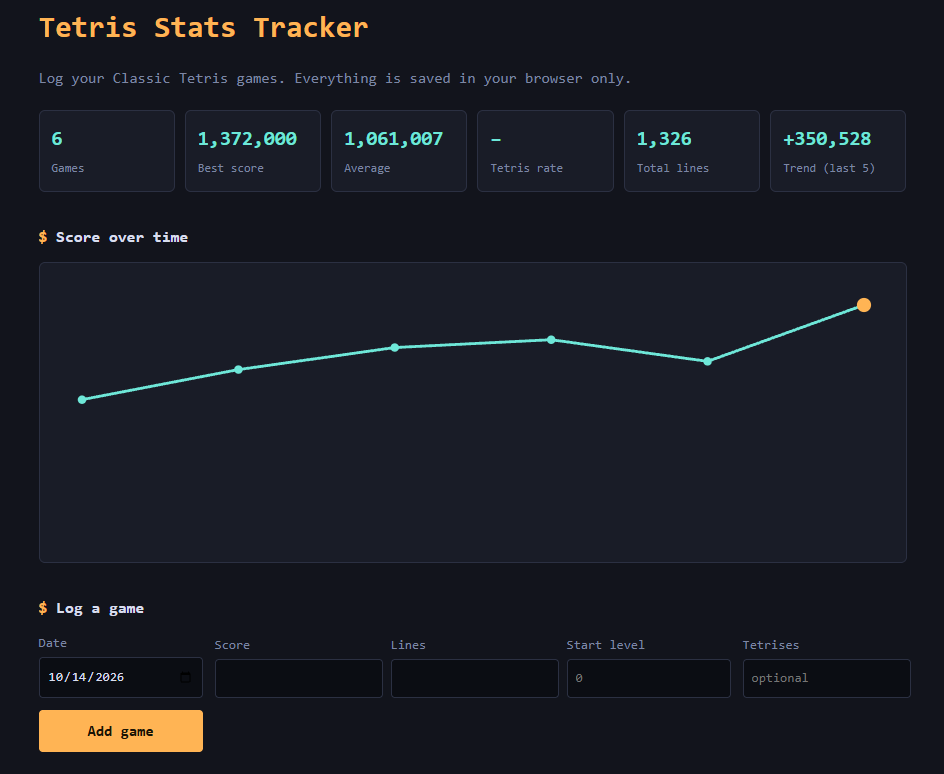

# Tetris Stats Tracker

**Live demo:** https://andya64.github.io/tetris-stats-tracker/



A small, dependency-free web app for logging Classic Tetris games and tracking progress over time.

## Features
- Log a game: date, score, lines, start level, and (optionally) tetrises
- Summary: games played, best score, average, tetris rate, total lines, and a trend (last 5 vs. the 5 before)
- Score-over-time line chart (inline SVG, no libraries)
- Delete games, export to JSON, and import from JSON
- Data stays in your browser (`localStorage`). No account, no server

## Run it
No build step. Open `index.html` in a browser.

## Test it
Requires Node.js 18+.

```bash
npm test
```

The calculation and validation logic lives in `stats.js` (no DOM), so it's unit tested with Node's built-in test runner.

## Deploy (GitHub Pages)
1. Push this repo to GitHub.
2. Repo **Settings → Pages**. Under *Build and deployment*, choose **Deploy from a branch**, branch `main`, folder `/ (root)`. Save.
3. After a minute it's live at `https://<your-username>.github.io/tetris-stats-tracker/`.

## Project structure
- `index.html`: page structure
- `style.css`: styling
- `stats.js`: pure logic (validation, summary stats)
- `stats.test.js`: unit tests
- `app.js`: UI, storage, and rendering

## Ideas for next
- Sync across devices with a small backend
- Per-level and per-mode breakdowns
- Import scores from a CSV
